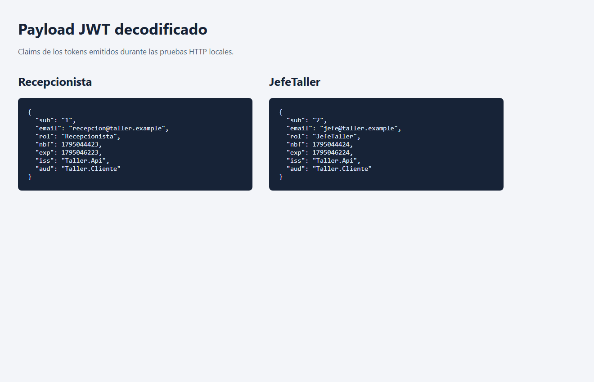
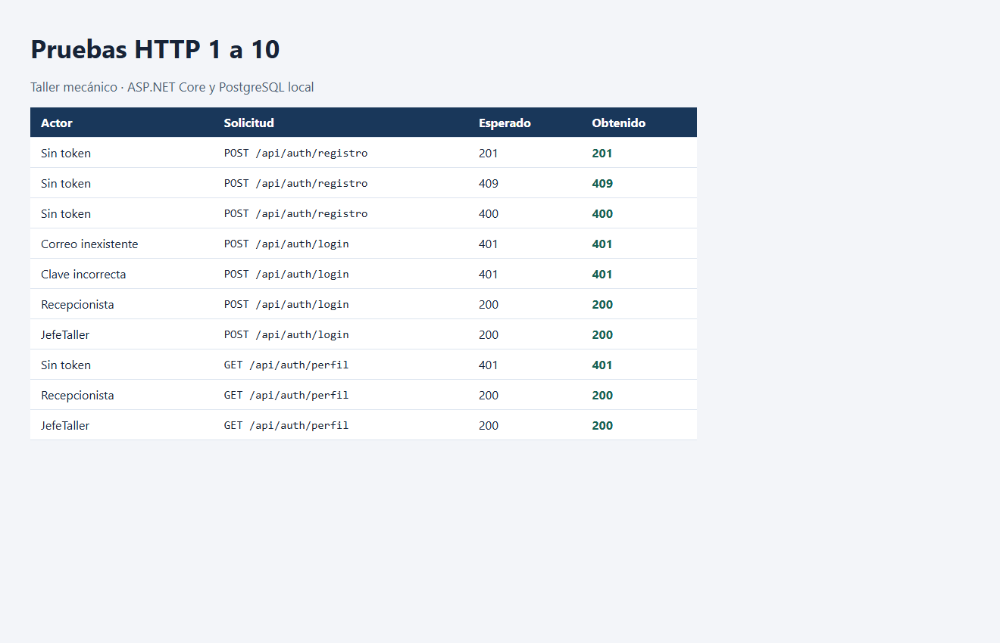
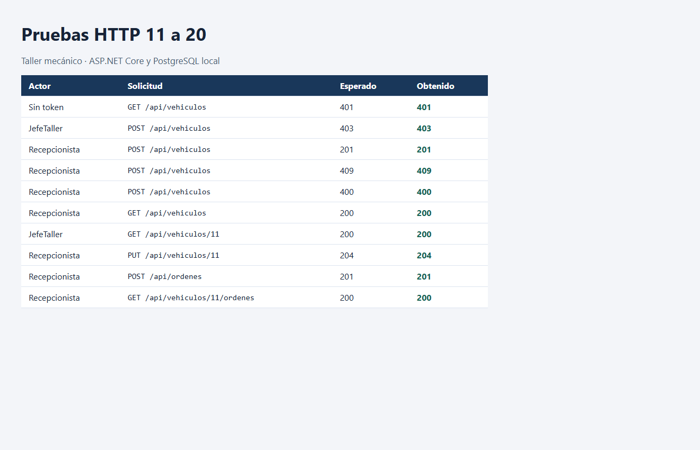
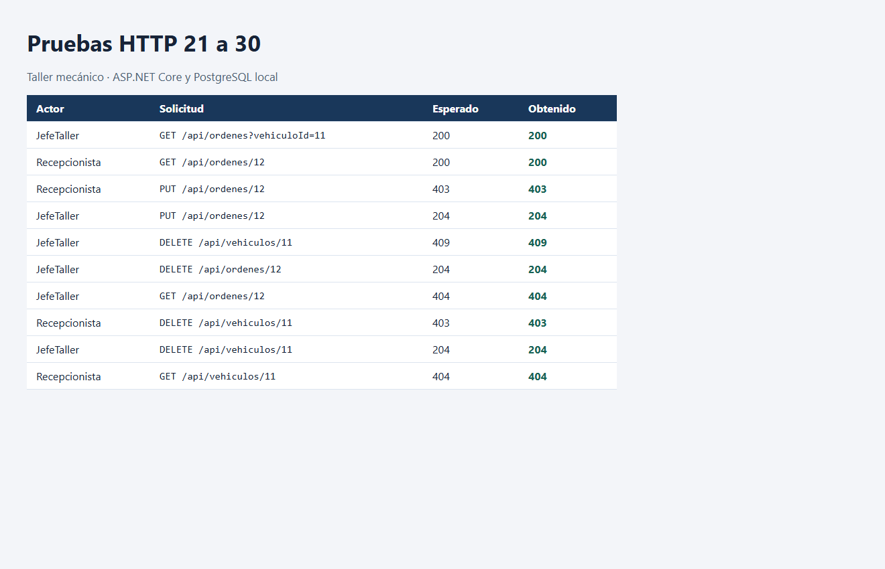
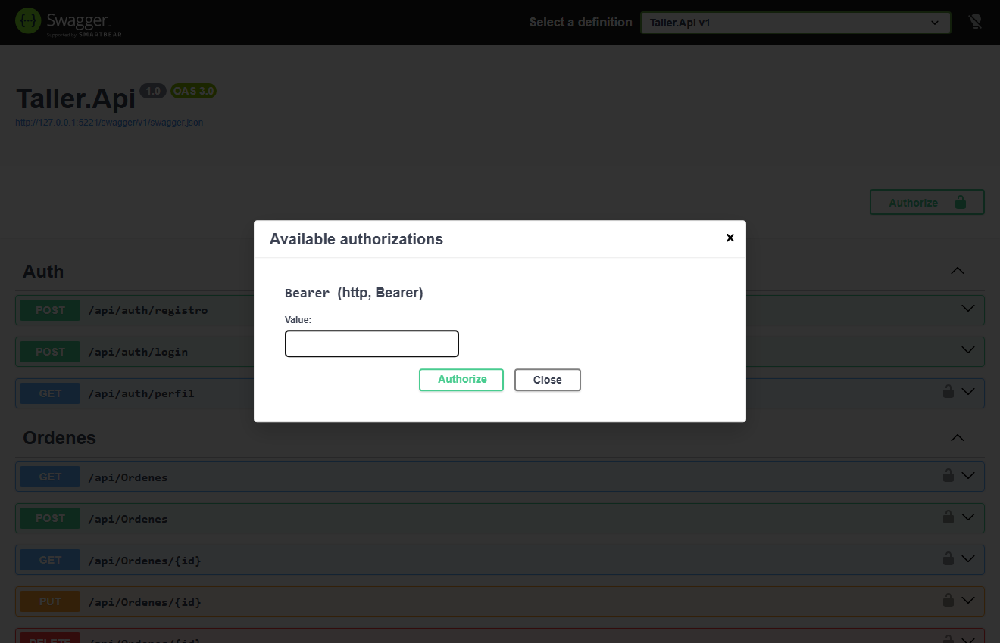

# Laboratorio 14 · API en capas con autenticación JWT

**Desarrollo de Aplicaciones Empresariales Avanzadas · Taller mecánico**

## Tema y roles

La API permite registrar los vehículos que llegan a un taller mecánico y hacer seguimiento a sus órdenes de trabajo, estado y costo estimado. Cada vehículo admite varias órdenes. La solución continúa los cuatro proyectos y el `MappingProfile` de la Semana 13.

- **Recepcionista** consulta vehículos y órdenes, registra y actualiza vehículos y abre órdenes de trabajo. El servidor asigna este rol al registrar una cuenta en el entorno de laboratorio.
- **JefeTaller** consulta vehículos y órdenes, abre órdenes, actualiza su estado y elimina órdenes. También puede eliminar vehículos que carecen de órdenes asociadas. Su rol se provisiona en la base de datos.

## Matriz de permisos

| Endpoint | Sin token | Recepcionista | JefeTaller |
|---|---|---|---|
| POST `/api/auth/registro` | Sí | Sí | Sí |
| POST `/api/auth/login` | Sí | Sí | Sí |
| GET `/api/auth/perfil` | 401 | Sí | Sí |
| GET `/api/vehiculos` | 401 | Sí | Sí |
| GET `/api/vehiculos/{id}` | 401 | Sí | Sí |
| GET `/api/vehiculos/{id}/ordenes` | 401 | Sí | Sí |
| POST `/api/vehiculos` | 401 | Sí | 403 |
| PUT `/api/vehiculos/{id}` | 401 | Sí | 403 |
| DELETE `/api/vehiculos/{id}` | 401 | 403 | Sí |
| GET `/api/ordenes` | 401 | Sí | Sí |
| GET `/api/ordenes/{id}` | 401 | Sí | Sí |
| POST `/api/ordenes` | 401 | Sí | Sí |
| PUT `/api/ordenes/{id}` | 401 | 403 | Sí |
| DELETE `/api/ordenes/{id}` | 401 | 403 | Sí |

«Sí» indica que la solicitud supera la comprobación de permisos. La validación del cuerpo y las reglas de negocio se aplican después. Los dos primeros endpoints son públicos. Las consultas y el perfil solo exigen autenticación. Las escrituras del taller exigen los roles indicados.

## Pruebas y evidencias

Se ejecutaron 30 solicitudes sobre la API local, con PostgreSQL y un token de cada rol. Se cubrieron los 14 endpoints y los ocho estados solicitados.

| HTTP | Caso observado |
|---|---|
| 200 | Login y perfil correctos con ambos roles; consultas de vehículos y órdenes. |
| 201 | Registro de una cuenta y creación de vehículo y orden por Recepcionista. |
| 204 | Actualización de vehículo por Recepcionista; actualización y eliminación de orden por JefeTaller. |
| 400 | Registro con correo inválido y creación de vehículo con cuerpo incompleto. |
| 401 | Perfil sin token; inicio de sesión con correo inexistente o clave incorrecta. |
| 403 | JefeTaller intenta registrar un vehículo; Recepcionista intenta actualizar una orden. |
| 404 | Consulta de una orden o de un vehículo tras eliminarlo. |
| 409 | Correo o placa duplicados; intento de eliminar un vehículo con órdenes. |

Los cuerpos de respuesta están en [pruebas.json](evidencias/pruebas.json) y los payloads decodificados en [claims.json](evidencias/claims.json). En Swagger UI se cargó el token de JefeTaller mediante Authorize y se ejecutó GET /api/auth/perfil con respuesta 200.

## Sustentación de seguridad

**¿Por qué se obtuvo 401 en un caso y 403 en otro?** `GET /api/auth/perfil` sin token devolvió 401 porque el servidor carecía de credenciales válidas para identificar al solicitante. `PUT /api/ordenes/{id}` con el token de Recepcionista devolvió 403 porque el token autenticó a esa cuenta y la operación requería JefeTaller. El login usa el mismo 401 para correo inexistente y clave incorrecta.

**¿Qué claims incluye el JWT y por qué?** `sub` identifica de forma estable al usuario, `email` contiene el correo y `rol` permite evaluar permisos. `iss` y `aud` delimitan quién emite el token y para quién sirve. `nbf` y `exp` delimitan su vigencia. La firma protege la integridad del contenido. El payload puede leerse, por lo que jamás incluiría contraseñas, hashes de contraseñas, claves secretas ni datos personales innecesarios.

**¿Qué se perdería al guardar contraseñas en texto?** Quien obtuviera acceso a una copia de la base podría leerlas y probarlas en otros servicios. BCrypt combina una sal individual y un factor de costo para encarecer cada intento de adivinación.

**¿Por qué el rol sale del token firmado?** El cliente controla el JSON de registro. Si la API aceptara un rol enviado en ese cuerpo, cualquiera podría solicitar el privilegio de JefeTaller. La API asigna el rol en el servidor, lo lee de la base al iniciar sesión y lo incluye en el JWT firmado. `GET /api/auth/perfil` recupera el correo y el rol del principal autenticado.

## Observaciones y conclusiones

- Se verificó que un campo `rol` adicional enviado al registro no cambia el rol que asigna el servidor.
- El índice único de PostgreSQL evita duplicados aun con registros concurrentes. La capa de negocio traduce ese conflicto a HTTP 409.
- La firma, la audiencia, el emisor y el vencimiento se validan en cada solicitud protegida. Los cambios de rol se reflejan en un nuevo token al iniciar sesión.
- El registro público con rol Recepcionista se usó en esta instancia académica. En un taller real, el alta de personal requeriría comprobación de identidad y autorización de la empresa.
- Los scripts [usuarios.sql](usuarios.sql) y [usuarios_demo.sql](usuarios_demo.sql) permiten repetir la configuración. La clave de firma y la cadena de conexión se proporcionan fuera del código fuente.

## Repositorio

El código, los scripts SQL y las evidencias están en GitHub. [Repositorio de la Semana 14](https://github.com/923327532/jwt_net). El enlace de la Semana 13 acredita el proyecto base. [Repositorio de la Semana 13, commit 17802b4](https://github.com/923327532/.netwithoracle/commit/17802b4885e22c2ba09a6b778f3dc85261856044)
